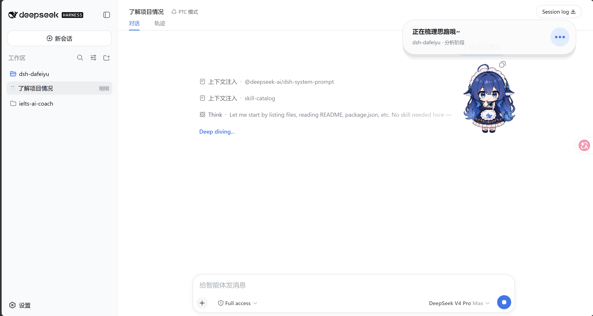
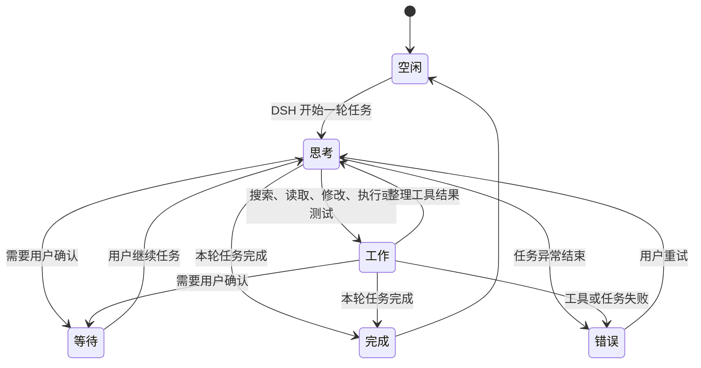
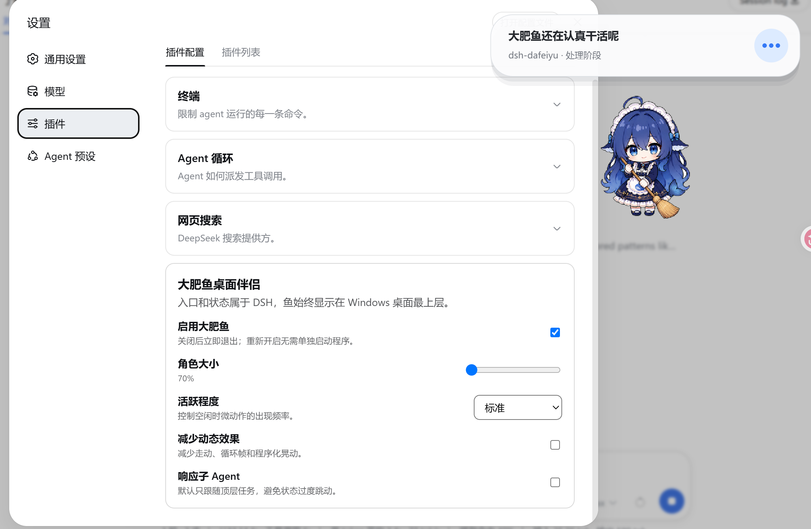

> [!IMPORTANT]
> **这是 [QCYTSN/dsh-dafeiyu](https://github.com/QCYTSN/dsh-dafeiyu) 的「提亮版」fork（非官方）。**
> 基线：上游 `0.1.14`（代码 MIT，视觉素材 MIT，见 [ASSET_LICENSE.md](ASSET_LICENSE.md)）。

<div align="center">

# 🐋 DSH 大肥鱼 · 提亮版

**原版桌宠画面偏暗？这是把全部 2600 帧动画整体提亮 1.25× 的版本。**

只调亮度，不改任何一行运行逻辑；动作、时序、角色设计与上游完全一致，只是不再那么暗。

</div>

## ✨ 为什么选提亮版

- 🌅 **更清晰**：把 `assets/pet/` 下全部 2600 帧以及 macOS helper 内嵌素材整体提亮 `1.25×`（逐帧 RGB 乘算，alpha 不变），浅色桌面、高亮屏上更易看清。
- 🔒 **零逻辑改动**：**没有改动任何一行运行逻辑**；角色设计、动作、时序与上游完全一致。
- 🎚️ **亮度可调**：想换别的亮度？`python tools/brighten-assets.py restore` 还原后再 `apply <系数>`（默认 1.25）。

## ⚠️ 先看这两条

1. **不要与上游 `dsh-dafeiyu` 同时安装**：两者注册同一组 HTTP 路由（`/plugins/dsh-dafeiyu/*`）与同名设置项。本 fork 是「替换式」安装：先移除上游，再装它。
2. **macOS**：替换 `.app` 内素材会让上游的临时签名失效，需自行 `codesign -s - --deep` 重签或清除隔离标记。

## 🚀 安装本 fork（3 步）

```powershell
# 1) 若已安装上游，先移除它（完全退出 DSH 后执行）
dsh plugin --profile web remove dsh-dafeiyu

# 2) 安装本 fork
dsh plugin --profile web add https://github.com/zhlipe/dsh-dafeiyu-bright

# 3) 照常启动 DSH —— 桌宠由插件自动拉起
```

> `desktop` profile 由 DSH 桌面端独占管理，CLI 会拒绝该 profile；那条路径请用桌面端自带的插件管理器（或写进 profile 的 package.json，再用 DSH 自带的 pnpm 安装）。

## 🖼️ 状态预览

| 思考 | 工作 | 完成 | 错误 |
| --- | --- | --- | --- |
|  |  |  |  |

> 原版未提亮时的画面对比图：欢迎在 [Issue](https://github.com/zhlipe/dsh-dafeiyu-bright/issues) 里补充，或加一张 `docs/images/before-after.png` 后更新本 README。

## 🔧 想换其他亮度？

```bash
# 还原为上游原始素材
python tools/brighten-assets.py restore

# 重新按指定系数提亮（如 1.5）
python tools/brighten-assets.py apply 1.5
```

---

<details>
<summary><b>📄 上游 DSH 大肥鱼完整文档（点击展开）</b></summary>

> 以下安装、截图与 npm 徽章指向原项目 [QCYTSN/dsh-dafeiyu](https://github.com/QCYTSN/dsh-dafeiyu)，仅供参考。本 fork 的安装请用上方「安装本 fork」的命令。

<div align="center">

# DSH 大肥鱼 🐋

**住在桌面上、由 DeepSeek Harness 真实工作状态驱动的 Agent 伴侣。**

入口属于 DSH，生命周期属于 DSH，显示层属于桌面。

[English](README_EN.md) · [npm](https://www.npmjs.com/package/dsh-dafeiyu) · [下载最新版本](https://github.com/QCYTSN/dsh-dafeiyu/releases) · [更新日志](CHANGELOG.md) · [更新与回退](docs/UPDATING.md) · [验收记录](docs/ACCEPTANCE.md)

[](https://www.npmjs.com/package/dsh-dafeiyu) · [](https://github.com/QCYTSN/dsh-dafeiyu/releases)

</div>



DSH 大肥鱼不是一个需要单独启动的桌宠应用。它由 DSH 插件启用，跟随 DSH
一起启动和退出，并以透明、无边框、始终置顶的原生窗口显示在桌面上。

> 当前版本：`0.1.14` · Windows / WSL2 / Linux x64 · macOS 实验性支持

### 关注最新进展

- 最新版本永远以 [npm `latest`](https://www.npmjs.com/package/dsh-dafeiyu) 和 [GitHub Releases](https://github.com/QCYTSN/dsh-dafeiyu/releases) 为准；顶部的版本徽章会自动更新。
- 给仓库 **Star 只是收藏，不会收到更新通知**。想第一时间知道更新：
    1. 打开仓库点 **Watch → Custom → Releases**，只订阅 Release 通知；
    2. 或直接订阅 Releases 的 feed：<https://github.com/QCYTSN/dsh-dafeiyu/releases.atom>
- 已安装用户升级：完全退出 DSH 后执行 `dsh plugin --profile web update dsh-dafeiyu`，然后重新启动 DSH。

### 它有什么用？

- **离开 DSH 页面也能看到状态**：大肥鱼始终显示在桌面最上层。
- **反馈来自真实 Agent 事件**：不读屏幕，不会把你在其他软件里的操作误判为 DSH 工作。
- **显示真实推理强度**：当 DSH 实际采用 reasoning effort 时，状态详情持续显示该值，不靠模型名猜测。
- **展示足够但不过量的信息**：项目名、当前阶段、进行中的步骤和真实待办进度会显示在状态卡上。
- **有生命力但不打扰**：思考、查找、修改、执行、验证、等待、完成和错误都有对应动作与文案。
- **没有第二套应用入口**：无需单独运行 Helper、安装 Python 或配置额外端口。

如果 DSH 没有提供待办清单，大肥鱼只显示“分析阶段”“实现阶段”“验证阶段”等可靠信息，不会编造完成百分比。

### 状态展示

| 思考 | 工作 |
| --- | --- |
|  |  |

| 等待确认 | 完成 |
| --- | --- |
|  |  |

| 遇到问题 |
| --- |
|  |

状态大致按照下面的流程变化：



多个 DSH Session 同时运行时，默认优先展示最需要注意的顶层任务：
`等待确认 > 错误 > 工作 > 思考 > 空闲`

### 系统要求

- Windows 10/11 x64，或 WSL2（通过 Windows interop 运行桌面 Helper）
- Linux x64 桌面（glibc ≥ 2.35；桌面实机仅在 Ubuntu 24.04 / glibc 2.39 验证）
- macOS 12.0+（Apple Silicon 或 Intel，实验性支持）
- 已安装并能正常运行的 DeepSeek Harness WebUI
- DSH CLI 中可以使用 `plugin --profile web` 命令
- npm 上的稳定版 `dsh-dafeiyu`（或抢先测试的 `dsh-dafeiyu@alpha`），或 GitHub Release 中的 `.tgz` 安装包

普通用户**不需要**安装 Python、PySide6 或单独运行 Helper。Windows、Linux x64 和 macOS 的 Helper 都已包含在发布包里。
当前 Alpha 版的设置与桌面状态文案使用简体中文。

### 安装插件

#### 1. 完全退出 DSH

先关闭 DSH Host，而不只是关闭浏览器标签页。安装或更新时不要让旧版插件继续运行。

#### 2. 命令安装

**Windows 用户**：在 PowerShell 中进入 DSH 安装目录（如 `cd D:\DSH`），然后：

```powershell
pnpm dsh plugin --profile web add dsh-dafeiyu
```

如果系统已能直接使用全局 `dsh` 命令，只需：

```powershell
dsh plugin --profile web add dsh-dafeiyu
```

想抢先试用新功能（`@alpha`）就把包名换成 `dsh-dafeiyu@alpha`。

DSH 运行在 WSL2 时，请在 WSL 终端执行同一条命令。可视模式下插件会自动通过 `cmd.exe` 启动包内的 **Windows** Helper，不需要手动 `chmod`，也不需要在 WSL 安装 Python 或 PySide6。

**Linux 用户（x64 桌面，glibc ≥ 2.35）**：

系统要求：x86_64 桌面发行版，glibc ≥ 2.35；桌面实机目前只在 Ubuntu 24.04（glibc 2.39）上验证过。需要图形会话（`DISPLAY` 或 `WAYLAND_DISPLAY`）。Debian / Ubuntu 桌面通常还需要 `libxcb-cursor0`。

```bash
cd ~/deepseek-harness
pnpm dsh plugin --profile web add dsh-dafeiyu
```

也可以从 [GitHub Releases](https://github.com/QCYTSN/dsh-dafeiyu/releases) 下载 `dsh-dafeiyu-<version>.tgz`（不要解压）后安装：

```bash
pnpm dsh plugin --profile web add ~/Downloads/dsh-dafeiyu-<version>.tgz
```

**macOS 用户（Apple Silicon / Intel，macOS 12.0+）**：

```bash
cd ~/deepseek-harness
pnpm dsh plugin --profile web add dsh-dafeiyu
```

macOS 的 `0.1.4` 首次提供实验性原生 Helper；当前应用只有 ad-hoc 签名，尚未 Developer ID 签名或公证。Gatekeeper 只在个别场景触发，放行方式见下方。

##### 关于 macOS Gatekeeper

实测（issue [#24](https://github.com/QCYTSN/dsh-dafeiyu/issues/24)）：从 npm 安装、用终端下载、以及浏览器下载 `.tgz` 后直接安装都不会触发拦截；只有用 Finder 解压出来的 `.app` 会携带隔离标记。推荐浏览器下载 `.tgz` 后**不要用 Finder 解压**直接安装；或用终端下载：

```bash
gh release download --repo QCYTSN/dsh-dafeiyu
# 或
curl -LO https://github.com/QCYTSN/dsh-dafeiyu/releases/download/v<版本>/dsh-dafeiyu-<版本>.tgz
```

#### 3. GitHub Release 备用安装方式

下载最新的 `dsh-dafeiyu-<version>.tgz`，**不要解压**，在 DSH 目录中安装：

```powershell
pnpm dsh plugin --profile web add "C:\Users\you\Downloads\dsh-dafeiyu-<version>.tgz"
```

#### 4. 启动 DSH

照常启动 DSH WebUI。插件默认启用，大肥鱼会由 DSH 自动拉起；不要手动打开 Helper。

#### 5. 找到设置入口

`设置 → 插件 → 插件配置 → 大肥鱼桌面伴侣`



### 怎么使用？

安装后不需要额外操作：启动 DSH → 开始一个项目任务 → 大肥鱼根据真实事件切换动作和状态卡 → 切到其他窗口继续工作 → DSH Host 退出后大肥鱼自动退出。

状态卡可能显示：项目目录名、当前阶段（“分析阶段”“实现阶段”“验证阶段”）、当前待办、真实进度（“已完成 3/5 步”）、等待/完成/错误提示。大肥鱼不会监听其他应用、不截图，只有 DSH Agent 事件能改变它的工作状态。

### 可配置项目

| 设置 | 作用 |
| --- | --- |
| 启用大肥鱼 | 立即显示或关闭桌面伴侣 |
| 角色大小 | 55%～140% 之间调整；右键菜单提供 60% 迷你档 |
| 气泡大小 | 80%～120% 之间调整状态气泡 |
| 气泡显示 | 常驻显示、完全隐藏，或自定义哪些状态显示气泡 |
| 活跃程度 | 控制空闲时眨眼、观察等微动作频率 |
| 减少动态效果 | 减少走动、循环帧和程序化晃动 |
| 提示音 | 控制任务完成或出错时的大肥鱼提示音 |
| 响应子 Agent | 允许子 Agent 状态参与优先级选择；默认关闭 |

设置由 DSH 保存，更新插件后通常不需要重新配置。

### 桌面互动

- **拖动**：按住移动位置，自动保存；松手后出现弹开、晕乎、抗议的短反馈。
- **点击/双击**：触发摸头、戳一下、尾巴等短互动。
- **右键菜单**：调整大小、气泡大小、减少动态、打开 WebUI、本次隐藏或本次关闭。

### 更新 / 回退 / 卸载

- 更新：完全退出 DSH 后 `pnpm dsh plugin --profile web update dsh-dafeiyu`，或重新执行安装命令；使用 GitHub Release 的可下载新 `.tgz` 覆盖安装。
- 回退：重新安装之前保留的旧版 `.tgz`。
- 卸载：完全退出 DSH 后 `pnpm dsh plugin --profile web remove dsh-dafeiyu`，再重启 DSH。

### 常见问题

<details><summary>安装后没有看到大肥鱼</summary>确认 `--profile web`；完全退出并重启 DSH Host；在“设置→插件→插件配置”勾选“启用大肥鱼”；确认用的是含对应平台预构建 Helper 的发布包。</details>

<details><summary>关闭了 DSH 网页，为什么大肥鱼还在？</summary>大肥鱼绑定的是 DSH Host 生命周期而非浏览器标签页；真正退出 DSH Host 后它会自动关闭。</details>

<details><summary>为什么没有显示数字进度？</summary>只有 DSH 写入结构化待办时才能可靠计算“已完成 3/5 步”；没有真实待办时只显示当前阶段，避免编造百分比。</details>

<details><summary>右键“本次关闭”后为什么没有自动回来？</summary>“本次关闭”只抑制当前运行期间的自动重启；完全退出并重启 DSH 后恢复。想永久关闭请在设置里取消“启用大肥鱼”。</details>

### 隐私与边界

- 不读取或保存模型 API Key · 不截图 · 不读其他窗口内容 · 不发送遥测 · 不监听键盘输入 · 不新开网络端口 · 默认只跟随最近活跃的顶层 DSH Session

### macOS 原生适配（AI 辅助生成）

本仓库的 macOS 原生 Helper（`runtime/bin/darwin/dsh-dafeiyu-helper.app`）及 `native/macos/` 下的 Swift 源码由 AI 辅助生成，经人工 review 后合入，用于替代原 Qt/PySide6 与 PyObjC 原型在 macOS 上不稳定、易崩溃的问题。重做了运行时（Swift + 纯 AppKit）、动画内核移植、全屏置顶、权限处理、稳定性修复、渲染交互修复与布局迁移。

兼容性：Universal binary（arm64 + x86_64），macOS 12.0+。构建说明见 `native/macos/README.md`。

### 开发与测试

```powershell
pnpm install
npm test
py -3 -m unittest discover -s runtime/tests -t .
```

从源码运行 Helper（开发用，正式用户勿手动启动）：

```powershell
py -3 -m pip install -r requirements.txt
py -3 runtime\helper.py
```

构建 Windows Helper：

```powershell
python -m pip install -r requirements.txt pyinstaller
$env:DSH_DAFEIYU_BUILD_PYTHON = (Get-Command python).Source
npm run build:helper:windows
```

构建 Linux Helper（需在 Linux x86_64 上；官方发布在 Ubuntu 22.04 上构建以保证 glibc 2.35 基线）：

```bash
python3 -m pip install -r requirements.txt pyinstaller
export DSH_DAFEIYU_BUILD_PYTHON="$(command -v python3)"
npm run build:helper:linux
```

macOS 原生 Helper 的构建说明见 `native/macos/README.md`。

### 更多文档

- [产品范围与取舍](docs/PRODUCT_SCOPE.md)
- [Windows 验收与性能记录](docs/ACCEPTANCE.md)
- [更新、回退与卸载](docs/UPDATING.md)
- [维护者发布流程](docs/RELEASING.md)
- [角色视觉资产许可](ASSET_LICENSE.md)

相关项目：[QCYTSN/ds-local-pet](https://github.com/QCYTSN/ds-local-pet)。

### License

代码采用 [MIT License](LICENSE)。角色动画素材来自社区项目 [dsh-pet](https://github.com/PC2005-cloud/dsh-pet)（MIT）；早期大肥鱼形象帧归档至 `legacy/dafeiyu/`，其原始受限条款继续适用。完整来源与边界见 [ASSET_LICENSE.md](ASSET_LICENSE.md)。

</details>

---

作者：zhlipe · 基于 [QCYTSN/dsh-dafeiyu](https://github.com/QCYTSN/dsh-dafeiyu) `0.1.14` 提亮改造
